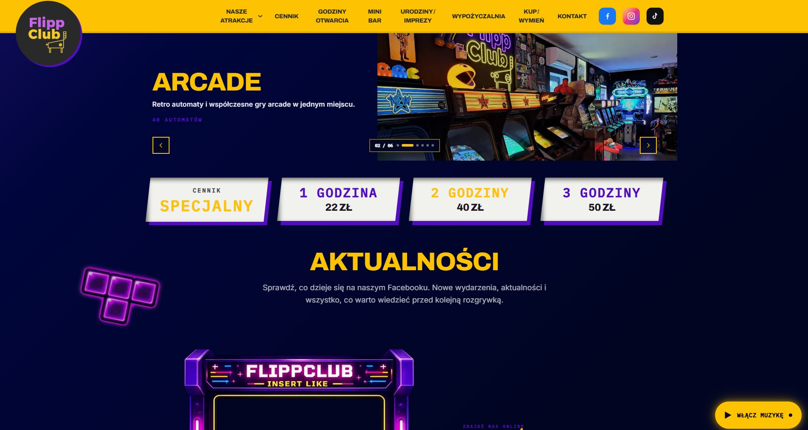

<div align="center">

# 🕹️ FLIPPCLUB

### ARCADE. FLIPPERS. GOOD TIMES.

**Official website of FLIPPCLUB — an arcade and pinball club in Siemianowice Śląskie, Poland.**



</div>

---

## 🎮 About the Project

FLIPPCLUB is a website for an entertainment venue bringing together classic pinball machines, arcade games and social experiences.

The website combines a distinctive visual identity inspired by retro gaming with clear navigation and easy access to essential visitor information. A dark navy background, bold yellow accents, neon purple details and expressive typography reflect the atmosphere of the club.

## ✨ Key Features

- **Arcade & Pinball** — dedicated pages showcasing the club's attractions.
- **Killer Queen** — a dedicated section for the team-based arcade game.
- **Pricing & Opening Hours** — quick access to essential visitor information.
- **Birthdays & Events** — a presentation of spaces available for celebrations.
- **Club Services** — information about the bar, rentals, and buying and exchanging machines.
- **Gallery & Social Media** — visual content and a Facebook feed section.
- **Responsive Design** — layouts adapted to desktop and mobile devices.
- **SEO Foundations** — dedicated routes, page metadata and a sitemap.

## 🛠️ Tech Stack

| Technology       | Purpose                           |
| ---------------- | --------------------------------- |
| Next.js 16       | Application framework and routing |
| React 19         | User interface                    |
| TypeScript       | Static typing                     |
| Tailwind CSS 4   | Styling                           |
| ESLint 9         | Code quality                      |
| Git & GitHub     | Version control                   |
| Cloudflare Pages | Production deployment             |

### Typography

The project uses locally installed fonts:

`Archivo` · `Archivo Black` · `IBM Plex Mono` · `Inter` · `Space Grotesk`

## 🚀 Getting Started

### Prerequisites

- Node.js
- npm

### Installation

Clone the repository and install dependencies:

```bash
git clone https://github.com/mstobrawa/flippclub.git
cd flippclub
npm install
```

Start the development server:

```bash
npm run dev
```

Open [http://localhost:3000](http://localhost:3000) in your browser.

## 📜 Available Scripts

| Command         | Description                         |
| --------------- | ----------------------------------- |
| `npm run dev`   | Start the development server        |
| `npm run build` | Create a production build           |
| `npm run start` | Start the Next.js production server |
| `npm run lint`  | Run ESLint                          |

## 📁 Project Structure

```text
flippclub/
├── public/             # Static assets and images
├── docs/               # README screenshots
├── src/
│   ├── app/            # Pages and application routing
│   ├── components/     # Reusable UI components
│   └── config/         # Navigation and slider configuration
├── next.config.ts
├── package.json
└── README.md
```

## 🌐 Deployment

The project is stored in a GitHub repository and deployed to **Cloudflare Pages**.

The production branch is `main`. Deployments are triggered according to the project's Cloudflare Pages configuration.

Before pushing changes, verify the production build:

```bash
npm run build
```

---

<div align="center">

**Designed & developed by Mike Webworks**

</div>
